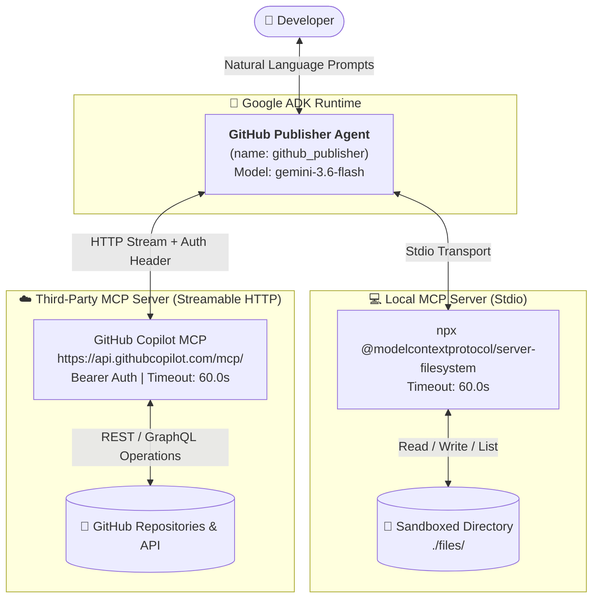
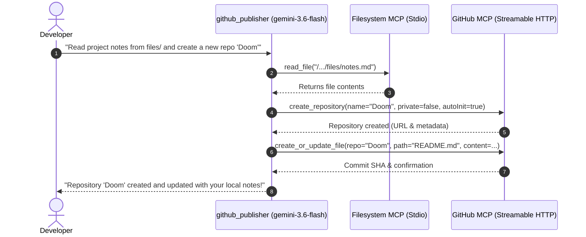

# 🚀 GitHub Publisher — Local-to-GitHub MCP Agent

**GitHub Publisher** (`github_publisher`) is an intelligent automation agent built with the **Google Agent Development Kit (ADK)** and powered by **`gemini-3.6-flash`**. It bridges your local machine and GitHub by connecting simultaneously to a **Local Filesystem MCP Server** (`Stdio`) and the **GitHub Remote MCP Server** (`Streamable HTTP`), enabling seamless file reading, repository creation, commit inspection, and code publishing through natural language.

> [!NOTE]
> **Sandboxed Security Design:**
>
> To protect your host system, the local filesystem MCP server is strictly sandboxed to a dedicated `./files/` directory inside the project folder. The agent cannot read, modify, or delete files outside this boundary.

---

## ✨ Key Highlights

* **Dual-MCP Architecture:** Orchestrates two independent Model Context Protocol (MCP) toolsets in a single agent—a local Node.js `Stdio` server for disk access and GitHub's cloud `Streamable HTTP` endpoint (`api.githubcopilot.com/mcp/`) for repository operations.
* **Strict Directory Sandboxing:** Automatically creates and isolates a local `files/` directory using Python's `pathlib.Path.resolve()`, ensuring safe file handling with absolute paths.
* **Resilient Session Timeouts (`60.0s`):** Configured with explicit `60.0`-second timeouts on both `StdioConnectionParams` and `StreamableHTTPConnectionParams` to prevent `npx` cold-start timeouts and idle HTTP connection drops.
* **End-to-End GitHub Workflows:** Supports creating repositories, searching repos, inspecting commit histories, reading/writing local project files, and pushing content directly to GitHub.
* **Fail-Fast Token Validation:** Validates the presence of `GITHUB_TOKEN` at startup via `python-dotenv` before initializing the agent runtime.

---

## 🏗️ Visual System Architecture



---

## 🔄 End-to-End Workflow Diagram



---

## 🔌 Configured MCP Toolsets

| MCP Server | Transport Type | Endpoint / Command | Timeout | Purpose & Scope |
| :--- | :--- | :--- | :--- | :--- |
| **Filesystem Server** | `StdioConnectionParams` | `npx -y @modelcontextprotocol/server-filesystem <folder>` | `60.0s` | Reads, writes, lists, and manages local files strictly inside `./files/`. |
| **GitHub MCP Server** | `StreamableHTTPConnectionParams` | `https://api.githubcopilot.com/mcp/` | `60.0s` | Authenticates via `Bearer GITHUB_TOKEN` to create repos, list commits, search code, and push files. |

---

## 📂 Project Structure & File Breakdown

```text
github-publisher-agent/
├── agent.py          # Main ADK Agent definition, env checks, and dual McpToolset setup
├── .env              # Secret credentials (GOOGLE_API_KEY, GITHUB_TOKEN)
├── files/            # Auto-created sandboxed workspace for local files
└── README.md         # Project documentation
```

### Component Breakdown (`agent.py`)
1. **Environment & Secret Guard:** Loads `.env` using `load_dotenv()` and raises an explicit `ValueError` if `GITHUB_TOKEN` is missing.
2. **Workspace Initialization:** Resolves `Path(__file__).parent.joinpath("files").resolve()` and runs `folder.mkdir(exist_ok=True)` so the sandbox directory always exists before the MCP server starts.
3. **Agent Definition (`root_agent`):**
   * **Name:** `github_publisher`
   * **Model:** `gemini-3.6-flash`
   * **Instruction:** Guides the LLM to use absolute paths inside `{folder}` for local filesystem tools and coordinate with GitHub MCP tools.
4. **Dual `McpToolset` Registration:** Attaches both the local `StdioServerParameters` toolset and the remote `StreamableHTTPConnectionParams` toolset with `60.0s` timeouts.

---

## 🚀 Quick Start & Setup

### 1. Prerequisites
* **Python 3.10+**
* **Node.js & `npx`** (must be available in your system `PATH` to spawn `@modelcontextprotocol/server-filesystem`)
* **Google Gemini API Key** (`GOOGLE_API_KEY`)
* **GitHub Personal Access Token (`GITHUB_TOKEN`):**
  * *Fine-grained PAT:* Enable **Repository permissions $\rightarrow$ Administration (Read & Write)** and **Contents (Read & Write)**.
  * *Classic PAT (`ghp_...`):* Enable the **`repo`** scope.

### 2. Installation

```bash
# Clone the repository
git clone <your-repo-url>
cd <project-folder>

# Create and activate a virtual environment
python -m venv venv

# Windows
venv\Scripts\activate

# macOS / Linux
source venv/bin/activate

# Install dependencies
pip install google-adk python-dotenv mcp
```

### 3. Configure Environment Variables

Create a `.env` file in the root directory alongside `agent.py`:

```env
GOOGLE_API_KEY=your_gemini_api_key_here
GITHUB_TOKEN=ghp_your_github_personal_access_token_here
```

### 4. Launch with Google ADK Web UI

Run the ADK web server from the parent directory of your agent folder:

```bash
adk web
```

Open the local URL displayed in your terminal (typically `http://127.0.0.1:8000`), select **`github_publisher`** from the agent dropdown, and start issuing commands.

---

## 🧪 Example Prompts & Workflows

Place any files you want the agent to read or publish inside the `./files/` folder, then try prompts like:

| Use Case | Example Prompt |
| :--- | :--- |
| **Create a Repository** | *"Create a new public GitHub repository named `Doom` with an initialized README."* |
| **Inspect Commit History** | *"Check my `Careerlyzer` repository and tell me the total commit count and the latest commit details."* |
| **Local File Inspection** | *"List all files inside my local folder and summarize the main points from `notes.md`."* |
| **Local-to-GitHub Publish** | *"Read `project_plan.md` from my local folder and push it to my `Doom` repository."* |

---

## 🛠️ Troubleshooting

* **`503 UNAVAILABLE` (Model High Demand):** This is a temporary server-side load spike on the Gemini API endpoint, not a quota exhaustion error. Wait a few seconds and retry, or switch `model` in `agent.py` to `gemini-2.5-flash`.
* **`MCP tool execution failed: Connection closed`:** Usually occurs if an idle HTTP MCP session expires in an old chat thread. Click **`+ New Session`** in the ADK Web UI to open a fresh MCP session.
* **`npx` Not Found / Timeout on Windows:** Ensure Node.js is installed (`node -v` and `npx -v` work in your terminal) and keep `timeout=60.0` in `StdioConnectionParams` so first-time package downloads complete smoothly.