# 🎬 CineVault — AI Movie Ticket Refund Agent

**CineVault** (`cine_vault`) is a conversational AI customer support agent built using the **Google Agent Development Kit (ADK)** and powered by **`gemini-3.5-flash-lite`**. It helps moviegoers check ticket refund eligibility, submit refund requests with interactive confirmation, auto-approve valid refunds, and track complete A-to-Z refund details.

> [!IMPORTANT]
> **Simulation & Testing Disclaimer:**
>
> This project is built strictly for **testing, learning, and demonstration purposes**. There is **no real payment gateway** connected to this system, and **no real bank money** is debited or refunded. All transactions, refund IDs, and timelines are simulated locally inside an SQLite database.

---

## ✨ Key Highlights

* **Lightweight & Fast LLM (`gemini-3.5-flash-lite`):** Optimized for low-latency, multi-step tool calling within free-tier API quotas.
* **Smart Auto-Date Dummy Database:** Running `dummy_db_creator.py` dynamically calculates show dates relative to **your current system date**, ensuring eligible and ineligible test cases always work out-of-the-box regardless of when you run the project.
* **Human-in-the-Loop Confirmation:** Uses ADK's built-in `adk_request_confirmation` prompt before modifying any database record.
* **Instant Auto-Approval & Tracking:** Once confirmed, the agent generates a unique `refund_id` (`RFD-YYYYMMDD-XXXXXX`), updates the booking status to `refunded`, and commits a **3 to 4 working days** source-account credit timeline.
* **Account Privacy Guardrail:** Strictly scopes all booking lookups and cancellations to the verified user's email session.

---

## 📸 Live ADK Web UI Walkthrough

Below is the complete end-to-end execution of **CineVault** running inside the Google ADK Web Interface (`adk web`).

### 🔹 Part 1: Identification, Eligibility Rules, Confirmation & Auto-Approval

#### 1. Greeting & Mandatory Email Verification
The agent welcomes the user and asks for their registered email address before accessing any booking records.
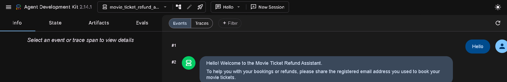

#### 2. User Lookup & Fetching Bookings (`identify_user` + `get_my_bookings`)
Upon receiving `rahul@example.com`, CineVault stores `user_id` and `user_email` in session state and lists Rahul's active bookings (`BKG1001` and `BKG1002`).
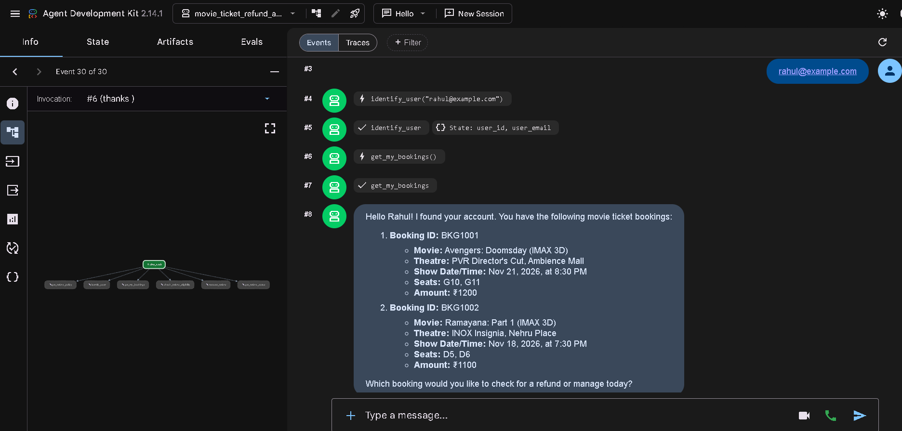

#### 3. Policy Enforcement: Ineligible vs. Eligible Check (`check_refund_eligibility`)
* **Ineligible (`BKG1002` - *Ramayana: Part 1*):** Rejected because the show is 1 day away (`Nov 18, 2026`), violating the 2-day advance cutoff rule.
* **Eligible (`BKG1001` - *Avengers: Doomsday*):** Approved for a full **₹1,200** refund (`Nov 21, 2026`), and the agent asks for a refund reason.
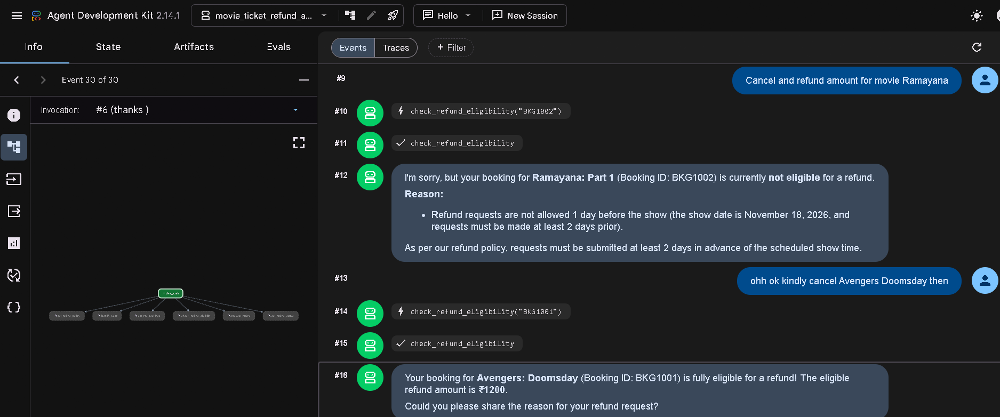

#### 4. Human-in-the-Loop Confirmation (`adk_request_confirmation`)
Once the user provides a reason (*"planned to watch somewhere else"*), `request_refund` pauses execution and triggers ADK's interactive confirmation dialog.
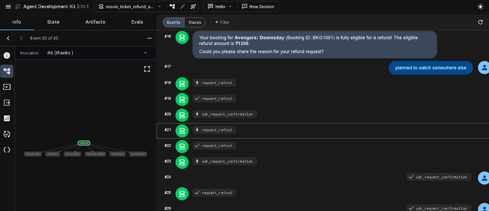

#### 5. Instant Auto-Approval & Refund Receipt
After the user confirms (`confirmed: true`), CineVault commits the refund to SQLite, generates **`RFD-20261117-135FFD`**, and confirms credit to the original UPI source account within **3 to 4 working days**.
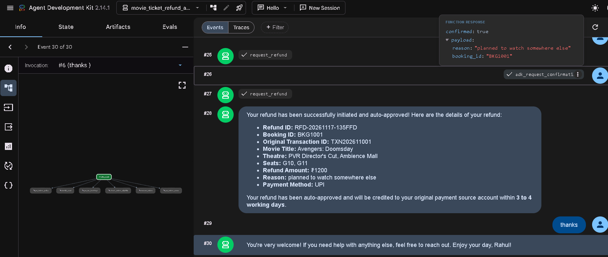

---

### 🔹 Part 2: A-to-Z Status Audit, Privacy Guardrail & Updated DB State

#### 6. New Session Status Inquiry
In a fresh session, the user asks for their refund status, and CineVault prompts for email verification again.
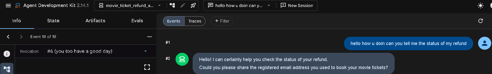

#### 7. Complete A-to-Z Refund Audit (`get_refund_status`)
After verifying `rahul@example.com`, CineVault retrieves the complete customer, movie, seat, and payment audit trail from `movie_tickets.db`.
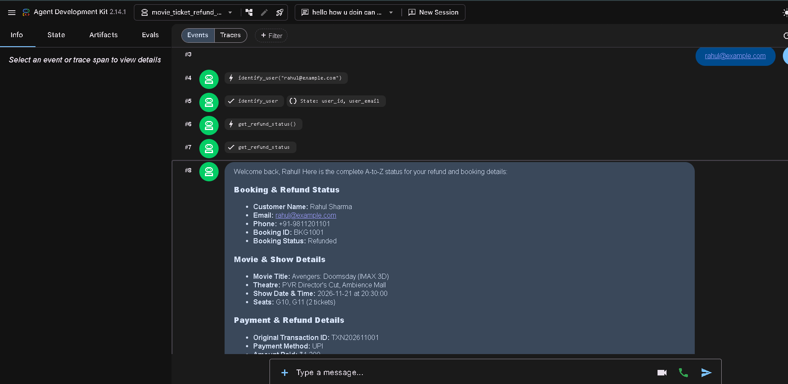

#### 8. Full Timestamp & Timeline + Privacy Guardrail Test
Shows the exact `Initiated & Approved At` IST timestamp and timeline. When the user tries to cancel another person's booking, CineVault enforces privacy rules and declines.
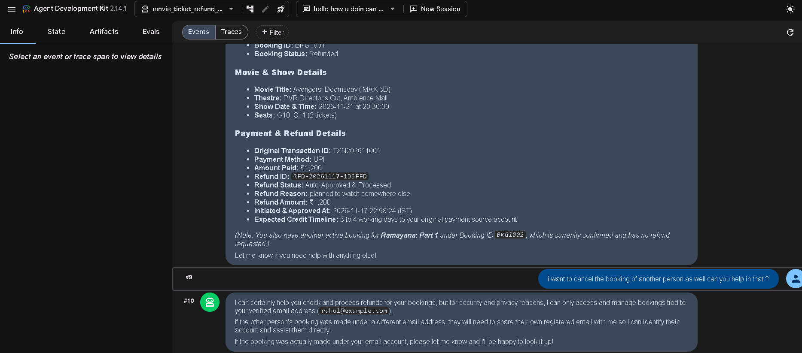

#### 9. Live Database State Verification (`get_my_bookings`)
Checking bookings again confirms `BKG1001` is now persisted as **`Refunded`** (`RFD-20261117-135FFD`) while `BKG1002` remains **`Confirmed`**.
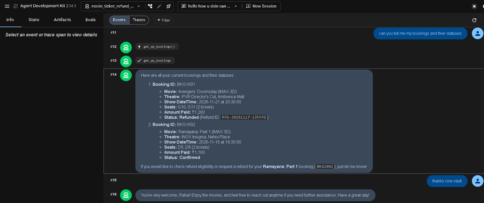

---

## 🏗️ Visual System Architecture

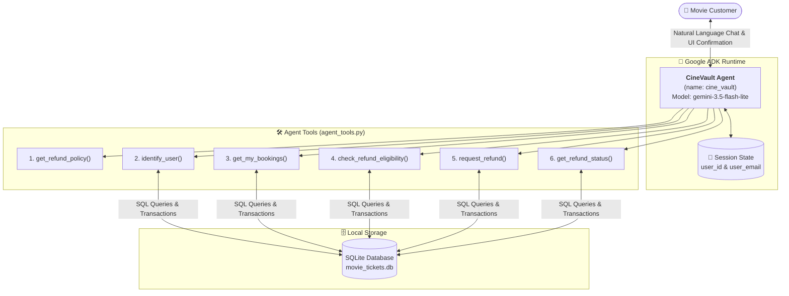

---

## 🔄 End-to-End Refund Workflow Diagram

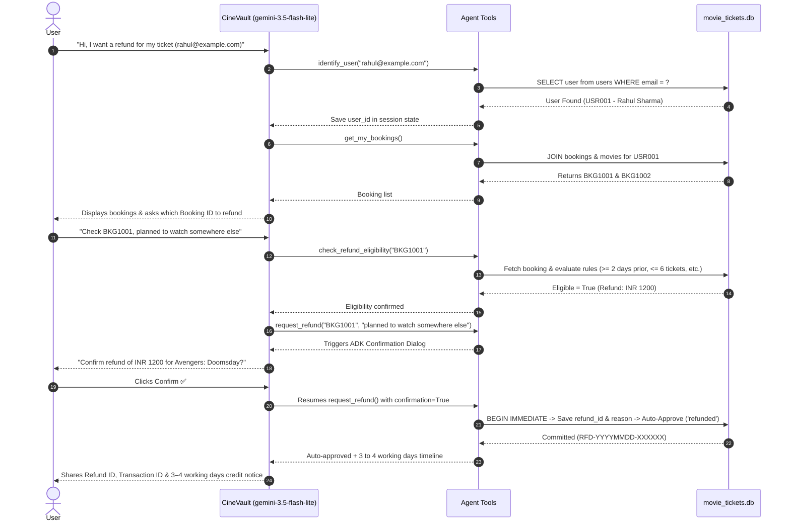

---

## 🗄️ Database Schema & Data Diagram

The SQLite database (`movie_tickets.db`) uses **3 normalized relational tables** with foreign key enforcement (`PRAGMA foreign_keys = ON`) and strict `CHECK` constraints.

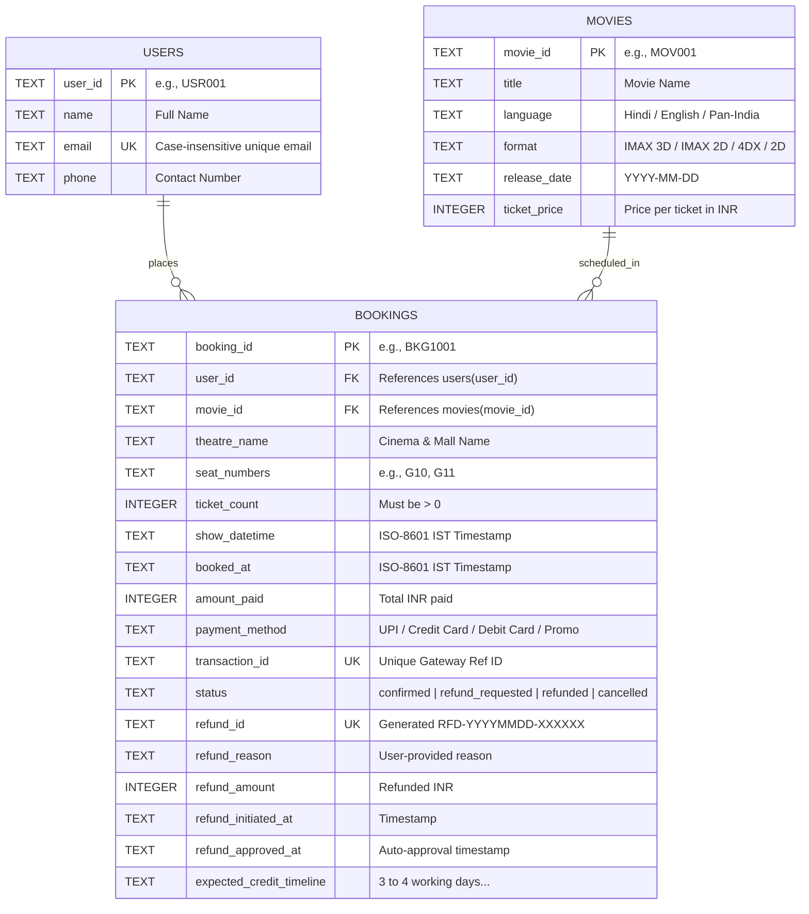

### 🕒 How Dynamic Auto-Date Generation Works

Inside `dummy_db_creator.py`, all show timestamps are generated dynamically relative to `datetime.now(IST)` at the exact moment you execute the script:

* `show_in_days(4)` $\rightarrow$ Creates shows **4 days in the future** (*Eligible*).
* `show_in_days(2)` $\rightarrow$ Creates shows **exactly 2 days in the future** (*Eligible boundary case*).
* `show_in_days(1)` $\rightarrow$ Creates shows **1 day before showtime** (*Ineligible cutoff case*).
* `show_in_days(0)` $\rightarrow$ Creates **same-day shows** (*Ineligible*).
* `days_ago(2)` $\rightarrow$ Creates **past shows** (*Ineligible*).

> **Tip:** If you want to reset the database or test on a new calendar date, simply delete `movie_tickets.db` and re-run `dummy_db_creator.py`.

---

## 📜 Refund Eligibility Rules

CineVault enforces **5 strict business rules** inside `evaluate_eligibility()`:

| # | Policy Rule | Condition | If Violated |
| :--- | :--- | :--- | :--- |
| **1** | **Booking Status** | Must be `'confirmed'` | Rejects already refunded or cancelled bookings. |
| **2** | **2-Day Advance Cutoff** | Show date must be at least **2 calendar days** away | Requests made **1 day before**, on the **same day**, or **after** the show are rejected. |
| **3** | **Bulk Ticket Cap** | Maximum **6 tickets** per booking (`ticket_count <= 6`) | Bookings with >6 tickets are blocked from online refunds. |
| **4** | **Paid Booking Check** | Minimum paid amount of **₹100** (`amount_paid >= 100`) | Free / ₹0 `Promo Voucher` tickets are non-refundable. |
| **5** | **Valid Reason** | User must supply a non-blank reason | Agent prompts the user for a reason before requesting confirmation. |

---

## 📂 Project Structure & File Breakdown

```text
cinevault-refund-agent/
├── agent.py                 # Main ADK LlmAgent definition (CineVault) & system prompt
├── agent_tools.py           # 6 Python tools, SQLite helpers, & refund policy engine
├── dummy_db_creator.py      # Auto-date SQLite generator (10 users, 5 movies, 15 bookings)
├── movie_tickets.db         # Generated SQLite database file
├── screenshots/             # ADK Web UI walkthrough screenshots (1.png to 9.png)
│   ├── 1.png
│   ├── 2.png
│   └── ... (3.png - 9.png)
└── README.md                # Project documentation
```

### 1. `agent.py`
* Defines `root_agent` using `google.adk.agents.LlmAgent`.
* Sets agent identity (`name="cine_vault"`) and LLM (`model="gemini-3.5-flash-lite"`).
* Contains structured instructions that enforce user identification via email, prevent hallucinating booking/payment numbers, trigger confirmation before saving refunds, and format A-to-Z refund status responses.

### 2. `agent_tools.py`
* Connects safely to `movie_tickets.db` using a transactional SQLite context manager (`BEGIN IMMEDIATE` during writes).
* Implements all **6 tools** exposed to the agent:
  1. `get_refund_policy()` — Returns the refund rules and timeline.
  2. `identify_user(email)` — Validates email, looks up the user, and stores `user_id` in `tool_context.state`.
  3. `get_my_bookings()` — Fetches all bookings joined with movie details for the logged-in user.
  4. `check_refund_eligibility(booking_id)` — Evaluates the 5 refund criteria against live DB records.
  5. `request_refund(booking_id, reason)` — Requests UI confirmation, records refund initiation with a unique `refund_id`, and **auto-approves** the status to `'refunded'`.
  6. `get_refund_status(booking_id)` — Returns complete customer, movie, payment, and refund audit details.

### 3. `dummy_db_creator.py`
* Builds `movie_tickets.db` from scratch with **5 hyped movies** (*Ramayana: Part 1*, *Avengers: Doomsday*, *Dune: Part Three*, *King*, *Jumanji: Open World*), **10 sample users**, and **15 diverse bookings** covering every eligible and ineligible edge case.

---

## 🚀 Quick Start & Setup

### 1. Prerequisites
* Python **3.10+**
* A valid **Google Gemini API Key** (`GOOGLE_API_KEY`)

### 2. Installation

```bash
# Install Google ADK
pip install google-adk

# Set your Gemini API key (Linux/macOS)
export GOOGLE_API_KEY="your_api_key_here"

# Or on Windows (PowerShell)
$env:GOOGLE_API_KEY="your_api_key_here"
```

### 3. Generate the Dummy Database

```bash
python dummy_db_creator.py
```

*Output:*
```text
Database created successfully: .../movie_tickets.db
  - users: 10 records
  - movies: 5 records
  - bookings: 15 records
```

### 4. Launch CineVault with ADK Web UI

Run this command from the parent directory of your agent folder:

```bash
adk web
```

Open the local URL shown in your terminal (usually `http://127.0.0.1:8000`), select **`cine_vault`**, and start chatting!

---

## 🧪 Ready-to-Use Test Scenarios

Use these pre-loaded accounts to test every workflow branch immediately:

| Test User Email | Booking ID | Movie | Test Scenario & Expected Outcome |
| :--- | :--- | :--- | :--- |
| **`rahul@example.com`** | `BKG1001` | *Avengers: Doomsday* | ✅ **Eligible** (4 days ahead, ₹1,200) — Full refund + auto-approval |
| **`rahul@example.com`** | `BKG1002` | *Ramayana: Part 1* | ❌ **Ineligible** — Show is 1 day away (violates 2-day advance rule) |
| **`neha@example.com`** | `BKG1008` | *King* | ✅ **Eligible** — Exact 2-day advance boundary test (₹840) |
| **`neha@example.com`** | `BKG1007` | *Avengers: Doomsday* | ❌ **Ineligible** — Bulk booking of 8 seats (`K1-K8` exceeds 6-ticket limit) |
| **`ananya@example.com`** | `BKG1010` | *Ramayana: Part 1* | ❌ **Ineligible** — Same-day showtime |
| **`priya@example.com`** | `BKG1004` | *Ramayana: Part 1* | ❌ **Ineligible** — Show date has already passed |
| **`arjun@example.com`** | `BKG1013` | *Avengers: Doomsday* | ❌ **Ineligible** — ₹0 `Promo Voucher` booking |
| **`aman@example.com`** | `BKG1005` | *Dune: Part Three* | 📋 **A-to-Z Status Check** — Already refunded (`RFD-20261115-88A12C`) |

### Sample Chat Prompts to Try
1. *"Hi! My email is `rahul@example.com`. Show me my movie bookings."*
2. *"Can I get a refund for `BKG1002`?"* *(Tests 1-day cutoff rejection)*
3. *"Okay, please refund `BKG1001` because I planned to watch somewhere else."* *(Tests confirmation & auto-approval)*
4. *"Give me the full A-to-Z refund status for `BKG1001`."* *(Tests full audit output)*